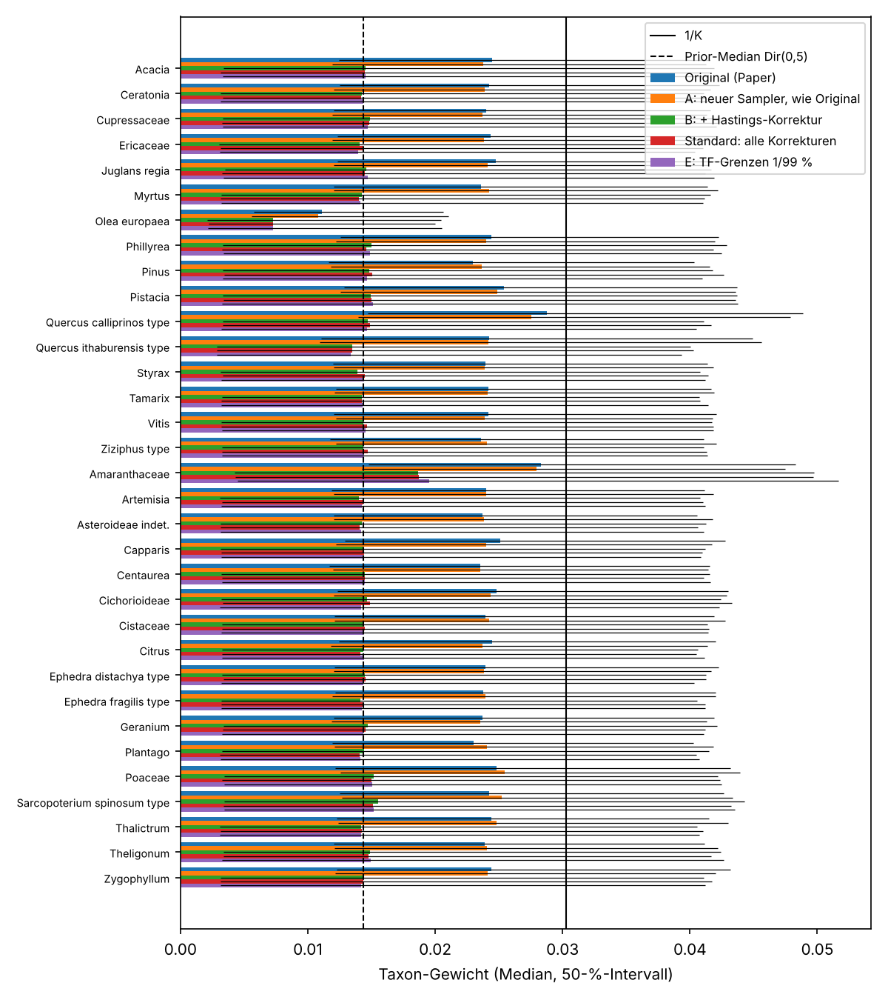
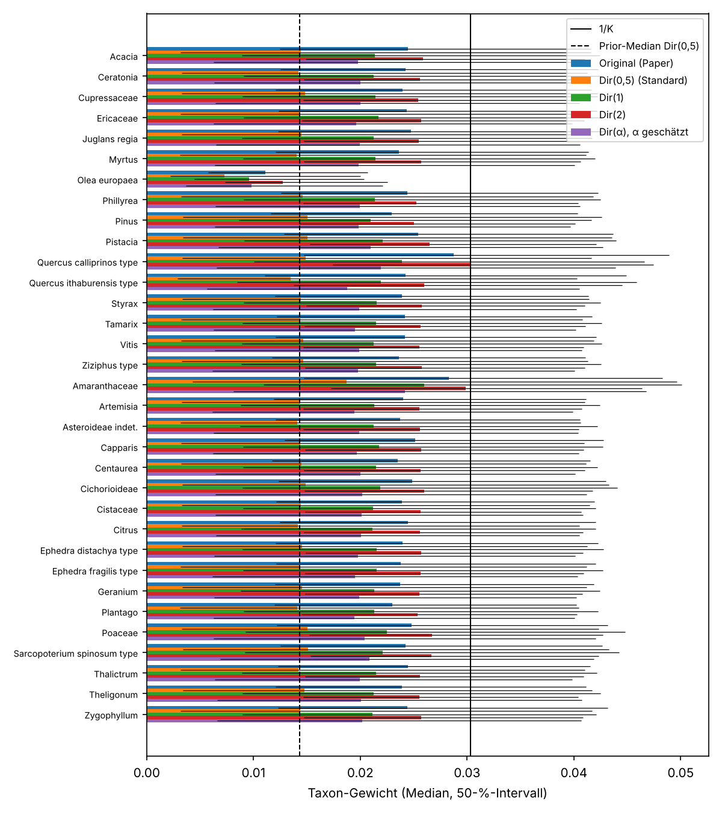
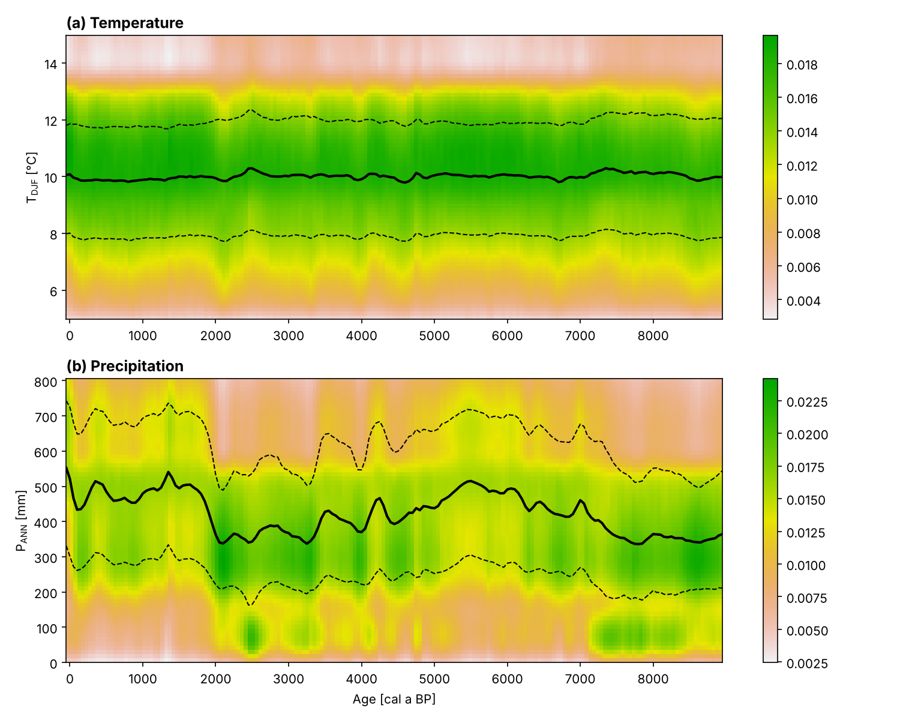
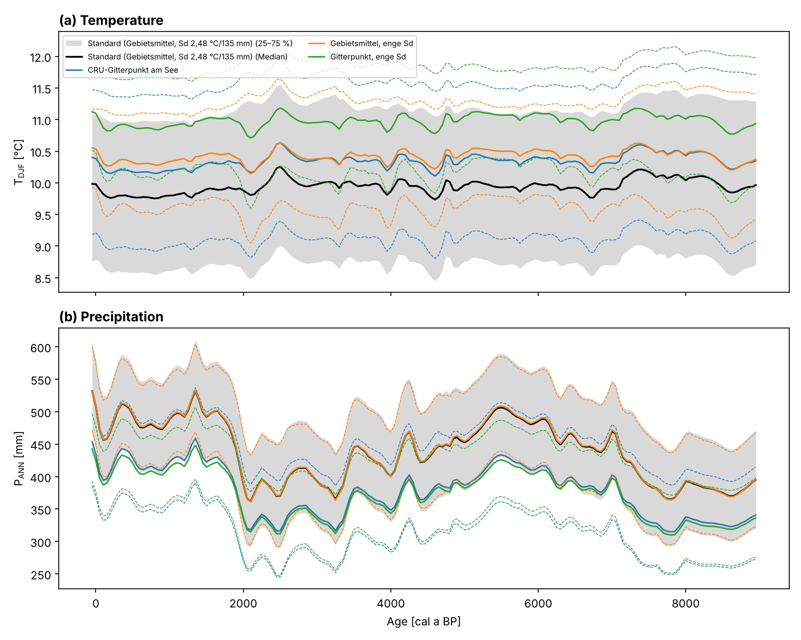
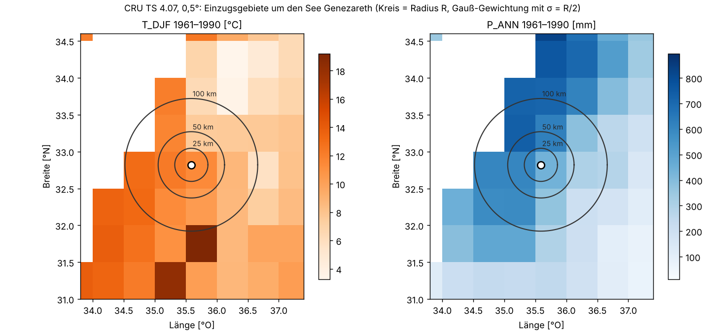
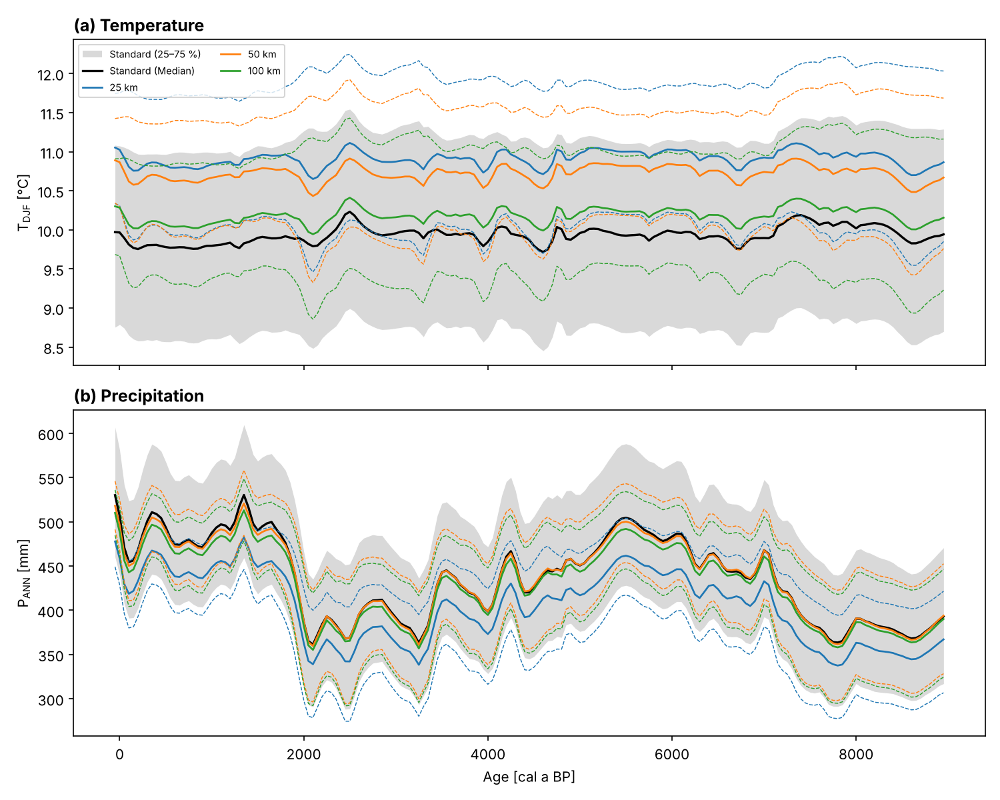
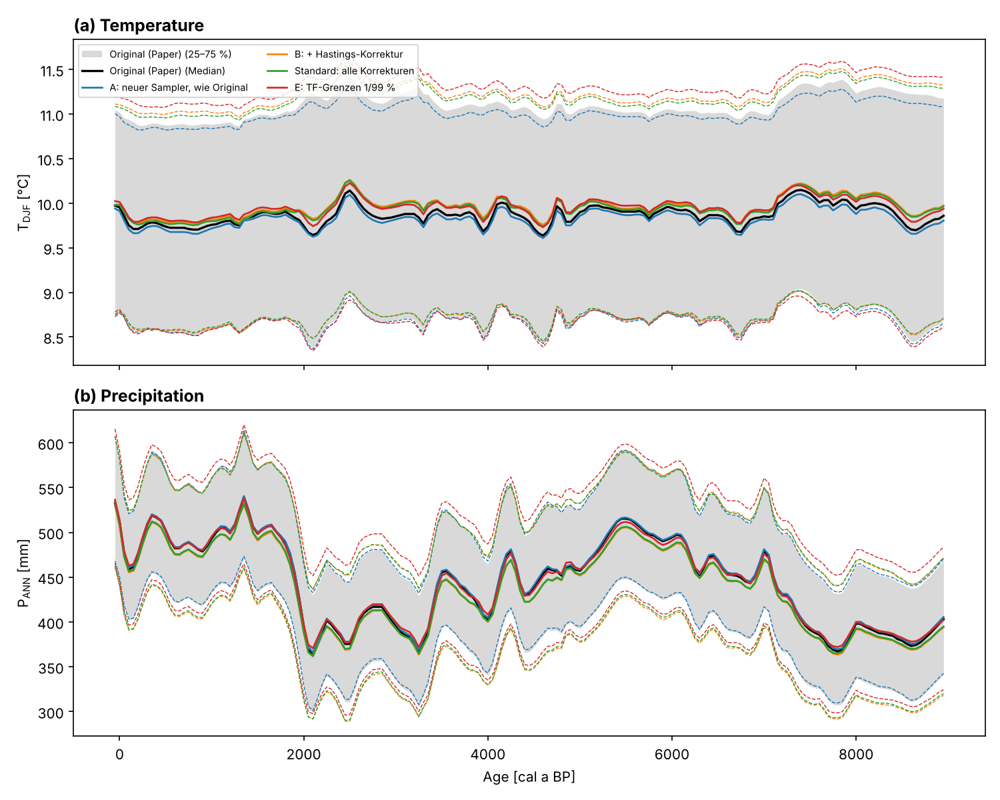

# Prüfbericht: Code zu Netzel et al. (2025), Clim. Past 21, 357–380

Stand: 27.10.2026. Geprüft wurde der Code der Publikation: Commit `782c6a0` (Stand von `main`).
Er unterscheidet sich vom Tag `v0.1.0` nur durch `LICENSE.md` und entspricht damit der im Paper
zitierten Zenodo-Version (doi:10.5281/zenodo.8214290).

Grundlage ist zum einen der Code selbst: mathematische Korrektheit des MCMC-Verfahrens, numerische
Umsetzung, Reproduzierbarkeit. Zum anderen der Abgleich Gleichung für Gleichung mit dem Paper
(`docs/paper/cp-21-357-2025.pdf`). Die vollständige Gegenüberstellung steht in `docs/abgleich_paper.md`.

## 1. Zusammenfassung

| # | Befund | Art | Auswirkung auf die Ergebnisse |
|---|---|---|---|
| 1 | Hastings-Korrektur des Dirichlet-Vorschlags ohne Streuungsparameter κ | **Fehler** (Mathematik) | Rekonstruktion: gering (≤ 0,18 °C, ≤ 12 mm; Unsicherheit bei P +15 %). Taxa-Gewichte: **deutlich** |
| 2 | Verhältnis „Posterior/Prior-CI“ der Transferfunktionen enthält einen Trunkierungseffekt | **Methodik**/Interpretation | Verengung für IT- und SA-Biom entsteht vollständig durch die Trunkierung, nicht durch die Daten |
| 3 | Posterior der TF-Werte stößt an die Trunkierungsgrenzen (v. a. T_Med) | Modellwahl, prüfen | Rekonstruktion robust (≤ 0,06 °C, ≤ 9 mm bei 1/99 % statt 5/95 %) |
| 4 | Startwerte von R², T0, P0 passen nicht zum Startzustand | Fehler (klein) | nur erste Iteration, keine |
| 5 | Gamma-Prior für P0 per Gittersuche statt analytisch | Ungenauigkeit | vernachlässigbar (Sd 135,16 statt 134,98 mm) |
| 6 | Φ⁻¹ im Sampler in einfacher Genauigkeit (`float`) | Ungenauigkeit | vernachlässigbar (~5·10⁻⁷) |
| 7 | Zufallszahlen compilerabhängig, Auswertung teilweise ungeseedet | Reproduzierbarkeit | Ergebnisse nur mit gleichem Compiler reproduzierbar; Prior-CI schwankt ~1 % |
| 8 | Schrittweite nach Rosenthal falsch skaliert (Varianz- statt Sd-Faktor) | Effizienz | keine (nur Mischungsgeschwindigkeit) |
| 9 | Kommentar „# wrong“ beim Klimagitter in `load_data.py` | Kommentar | keine. Die Orientierung ist korrekt (Test `test_grid_orientation`) |
| 10 | Laufzeit, Speicher, Kompatibilität (NumPy 2, Matplotlib ≥ 3.9) | Technik | Original läuft mit aktuellen Bibliotheken nicht mehr |
| 11 | Taxa-Gewichte hängen stark von der Prior-Konzentration α ab (Dir(α)) | Empfindlichkeit | Rekonstruktion robust (≤ 0,1 °C, ≤ 10 mm); Höhe und Rangfolge der Gewichte nicht |
| 12 | Code bildet je Stichprobe den **Mittelwert** der Biom-Klimawerte, Gl. (3) beschreibt eine **Mischverteilung** | Paper ↔ Code | Mediane gleich; Unsicherheit bei Mischung 1,7× (T) bzw. 3× (P) |
| 13 | R²-Prior mit α₁ < 1 (Paper-Sensitivität „R² = 0,25“): Kette bleibt im Zustand R² = 0 hängen | **Fehler** | Der Lauf des Papers mit R² = 0,25 ist mit keiner der beiden veröffentlichten Fassungen (R, Python) reproduzierbar |
| 17 | Python-Portierung startet die TF-Klimawerte an der oberen Grenze, die R-Fassung beim Median | Portierung | keine (Burn-in) |
| 14 | Gl. (14): N_t(μ(ψ), σ(ψ)) als P(C\|ψ); im Code nur Random-Walk-Vorschlag, Prior von C gleichverteilt | Paper ↔ Code | klären (Modellgleichung oder nur Vorschlag?) |
| 15 | Beta-Prior des R²: Tab. 2 nennt (2,62; 2,62), Abb. 4 und Code verwenden (3; 3) | Paper ↔ Code | gering (Sd 0,19 statt 0,20) |
| 16 | Konvergenz laut Paper per multivariatem Gelman-Rubin (1,001); der Code hat 1 Kette und keine Diagnostik | Reproduzierbarkeit | Split-R̂ der Kette ≤ 1,002, für die (fehlerhafte) Zielverteilung also konvergiert |

## 2. Vorgehen

1. **Referenz.** Das Original wurde mit minimalen Kompatibilitäts-Patches ausgeführt
   (`legacy/README.md`) und die Ergebnisse in `reference/v1.0-paper/` gesichert.
2. **Umbau ohne Verhaltensänderung.** Das neue Paket enthält den Original-Sampler unverändert. Es
   reproduziert Kette, Akzeptanzentscheidungen, alle Quartile und die Abbildungen **bitidentisch**
   (Tests `test_legacy_equivalence.py`).
3. **Überarbeiteter Sampler.** Jede Korrektur ist einzeln abschaltbar. Mit allen Korrekturen aus
   (Lauf A) stimmt der Sampler statistisch mit dem Original überein: höchstens 0,06 °C und 3 mm
   Unterschied im Median, also Monte-Carlo-Streuung.
4. **Validierung an bekannten Lösungen.** Ohne Daten muss eine korrekte Kette den Prior
   wiedergeben (Tests `test_sampler_validation.py`).
5. **Vergleichsreihe.** Die Korrekturen wurden schrittweise eingeschaltet (Abschnitt 4), jeweils
   mit 4 Ketten und R̂ ≤ 1,01 und ESS ≥ 400 für alle 43 Größen.

## 3. Befunde im Einzelnen

### 3.1 Hastings-Korrektur der Taxa-Gewichte (Befund 1)

Die Taxa-Gewichte werden mit w′ ~ Dir(κ·w) vorgeschlagen, κ = K² = 1089
(`new_taxa_weights`). Die Hastings-Korrektur muss daher

  q(w | w′) / q(w′ | w) = Dir(w; κ·w′) / Dir(w′; κ·w)

lauten. `taxa_weights_ratios` berechnet aber Dir(w; w′) / Dir(w′; w), also **ohne κ**:

```cpp
double proposal_ratio1 = lgamma(sum_vector(new_weights)) - sum_vector(lgamma_vector(new_weights))
                       + sum_vector(vector_weight_vector(vector_subtract(new_weights,1),log_old_w));
```

Damit erfüllt die Kette die Detailed-Balance-Bedingung für die beabsichtigte Posterior nicht. Ihre
stationäre Verteilung ist eine andere, analytisch nicht angebbare Verteilung.

**Nachweis (Prior-only-Lauf).** Ohne Kalibrierung und Transferfunktion ist die Zielverteilung der
Gewichte genau der Jeffreys-Prior Dir(0,5, …, 0,5):

| | Sd(w) | Median(w) | P(w < 0,001) |
|---|---|---|---|
| Sollwert Dir(0,5) | 0,0410 | 0,0143 | 0,141 |
| korrigierter Sampler | 0,0410 | 0,0143 | 0,140 |
| Verhalten des Originals | 0,0246 | 0,0241 | 0,012 |

Das Original zieht die Gewichte also systematisch zu 1/K hin. Das wirkt wie ein deutlich
informativerer Prior als der angegebene.

**Auswirkung mit Daten** (Lauf B gegen Original):

- Rekonstruktion: Median T höchstens 0,18 °C, Median P höchstens 12 mm verschoben (im Mittel −7 mm).
  Der Interquartilsabstand von P wächst um 15 % (131 → 151 mm), der von T um 5 %. Das mittlere R²
  mit der AP-Kurve sinkt von 0,64 auf 0,55.
- **Taxa-Gewichte:** Mit korrekter Korrektur liegen die Posterior-Gewichte fast aller Taxa beim
  Prior-Median (≈ 0,014–0,015, siehe Abbildung unten). Klar von den Daten bestimmt sind nur
  *Amaranthaceae* (höher, Median 0,019), *Olea europaea* (niedriger, 0,007) und schwächer
  *Quercus ithaburensis type* (0,013). Die im Abstract genannte hohe Gewichtung von *Quercus
  calliprinos type* (Original 0,029) **verschwindet** unter Dir(0,5) (0,015 ≈ Prior). Mit einem
  weniger extremen Prior (α ≥ 1) kehrt sie zurück (siehe 3.6). Die Aussagen zu *Amaranthaceae* und
  *Olea* sind unter allen geprüften Priors stabil.



**Gegenprobe.** Dieselbe korrigierte Zielverteilung wurde mit zwei verschiedenen Vorschlägen
gerechnet: dem Dirichlet-Random-Walk des Originals mit korrekter Korrektur (5 Mio. Iterationen) und
dem neuen log-Gamma-Random-Walk. Beide stimmen überein (T 9,93 gegen 9,96 °C, P 436 gegen 438 mm,
gleiche Gewichte).

### 3.2 Verhältnis „Posterior/Prior-CI“ der Transferfunktionen (Befund 2)

Die TF-Klimawerte werden auf das 5-%- bis 95-%-Quantil der Prior-Randverteilungen trunkiert. Die
Auswertung vergleicht die Posterior aber mit dem 95-%-Intervall der **untrunkierten** Randverteilung,
und die P-Werte stammen dabei vom nichtlinearen Klimagitter. Schon ohne jede Information aus den
Daten (Prior-only-Lauf) ergibt sich deshalb ein Verhältnis < 1:

| 95-%-CI post/prior | T Med | T IT | T SA | P Med | P IT | P SA |
|---|---|---|---|---|---|---|
| Original (Abbildung im Paper) | 0,68 | 0,80 | 0,64 | 0,62 | 0,79 | 0,76 |
| ohne Daten, gleiche Methode | 0,88 | 0,80 | 0,64 | 0,77 | 0,79 | 0,76 |
| **korrekte Referenz** (Prior-Lauf des Modells) | **0,79** | **1,00** | **1,02** | **0,81** | **0,99** | **1,00** |

**Folgerung:** Für das irano-turanische und das saharo-arabische Biom liefern die Daten **keine**
Information über die Klimabereiche. Die gezeigte Verengung ist ein Effekt der Trunkierung. Beim
mediterranen Biom werden die Intervalle durch die Daten um rund 20 % enger. Das stützt die Aussage
im Abstract, dass sich das mediterrane Biom am stärksten ändert, aber mit geringerem Ausmaß.
Das Paket verwendet jetzt standardmäßig die korrekte Referenz (`prior_reference = "model"`).

### 3.3 Trunkierungsgrenzen (Befund 3)

In der Posterior liegen 8,9 % der T_Med-Werte im obersten 5-%-Band des erlaubten Bereichs
(gleichverteilt wären es 5 %), bei T_SA 7 % im untersten Band. Die Grenzen sind eine Modellwahl.
Die Empfindlichkeitsrechnung mit 1 %/99 % (Lauf E) verschiebt die Rekonstruktion gegenüber dem Standardlauf höchstens um
0,06 °C bzw. 9 mm und weitet die Unsicherheit leicht (IQR P +5 %). Die Rekonstruktion ist also
robust. Die Wahl sollte im Paper aber begründet werden.

### 3.4 Kleinere Befunde (4–9)

- **Startwerte (4):** `prior[0..2][0]` werden zufällig gesetzt (0,2 / 4 °C / 200 mm) statt aus dem
  Startzustand berechnet. Der erste MH-Schritt vergleicht daher mit einem nicht existierenden
  Zustand. Nach dem Burn-in ohne Wirkung. Korrigiert: Der Startzustand wird ausgewertet.
- **Gamma-Prior (5):** Form 16,938 / Rate 0,030451 (Gitter) statt 16,982 / 0,030530 (exakt).
- **Φ⁻¹ (6):** `my_erfinvf` rechnet in `float`. Ersetzt durch AS241 in `double`.
- **Reproduzierbarkeit (7):** `std::default_random_engine` und `std::gamma_distribution` sind
  implementierungsabhängig, also auf einem anderen Compiler andere Ketten. Zusätzlich ein eigener
  Park-Miller-Generator je Iteration mit Seeds aus Python. Neu: ein portabler Generator
  (`mt19937_64` mit eigenen Verteilungen), Seeds je Kette aus `numpy.random.SeedSequence`.
- **Rosenthal-Skalierung (8):** Kommentar und Code skalieren die Standardabweichung mit 2,38²/K.
  Rosenthal (2010) skaliert die *Varianz* mit 2,38²/d. Außerdem ist d die Dimension des
  gemeinsamen Vorschlags (39), nicht K = 33. Beeinflusst nur die Effizienz.
- **Klimagitter (9):** Der Kommentar `# wrong` / `# maybe correct` ist unbegründet. Die
  Randverteilungen werden über die richtigen Achsen gebildet.

### 3.5 Technik (10)

- Mit NumPy ≥ 2 und Matplotlib ≥ 3.9/3.10 bricht das Original an sechs Stellen ab. Außerdem
  scheitert die Kompilierung, wenn `python3-config` zu einer anderen Python-Version gehört.
- Laufzeit des Originals: MCMC ~60 s (Spitzenspeicher ~3 GB, weil alle 10⁶ Zustände als
  Python-Listen übergeben werden), Auswertung 576 s.
- Das Paket braucht im Legacy-Modus 37 s für das MCMC und 10 s für die Auswertung, mit
  bitidentischen Ergebnissen. Im Standardlauf mit 4 Ketten × 2 Mio. Iterationen sind es 93 s.

### 3.6 Prior der Taxa-Gewichte (Befund 11)

Weil die Daten die Gewichte nur schwach bestimmen, hängt deren Posterior stark von der Konzentration
α des Priors Dir(α, …, α) ab. Geprüft wurden α = 0,5 (Paper), α = 1 (gleichverteilt auf dem
Simplex), α = 2 und ein **hierarchischer Prior**, bei dem α mitgeschätzt wird
(log α ~ N(log 1, 1), also 95 % der Prior-Masse zwischen 0,14 und 7,1).

| Prior | T Median | P Median | IQR P | R² | Median w: *Olea* / *Q. calliprinos* / *Amaranthaceae* | P(w < 0,001) |
|---|---|---|---|---|---|---|
| Original (fehlerhaft) | 9,87 °C | 444,9 mm | 131,5 | 0,64 | 0,011 / 0,029 / 0,028 | 0,01–0,02 |
| Dir(0,5) | 9,94 | 438,6 | 149,7 | 0,55 | 0,007 / 0,015 / 0,019 | 0,12–0,15 |
| Dir(1) | 9,88 | 443,6 | 136,2 | 0,61 | 0,010 / 0,024 / 0,026 | 0,03–0,05 |
| Dir(2) | 9,83 | 448,6 | 123,6 | 0,68 | 0,013 / 0,030 / 0,030 | < 0,01 |
| Dir(α), α geschätzt | 9,90 | 443,0 | 139,0 | 0,60 | 0,010 / 0,022 / 0,024 | 0,09–0,12 |

Der hierarchische Lauf schätzt **α = 0,82** (95 %: 0,15–4,6). Die Daten schließen große α also
etwas aus, legen α aber nicht fest. Dafür waren 4 Ketten × 8 Mio. Iterationen nötig, weil α an
die kleinen Gewichte gekoppelt ist und langsam mischt (R̂ 1,002, ESS(α) 2064).

**Folgerungen:**
- Die Klimarekonstruktion ist gegenüber dem Prior robust: Die Mediane liegen innerhalb von 0,11 °C
  und 10 mm. Die Unsicherheit von P schwankt je nach Prior um etwa ±10 %.
- Auch die Information über die Transferfunktionen hängt nicht vom Prior ab: Für das mediterrane
  Biom liegt das CI-Verhältnis bei allen Priors bei 0,77 bis 0,82, für die anderen beiden bei etwa 1.
- Die Rangfolge der Gewichte (*Amaranthaceae* und *Q. calliprinos* vorn, *Olea* hinten) ist ab
  α ≥ 1 und im hierarchischen Modell stabil. Die **Beträge** hängen dagegen vom Prior ab und sollten
  nur mit Angabe des Priors berichtet werden.
- **Empfehlung:** der hierarchische Prior (`configs/g_dir_hierarchisch.toml`). Er legt α nicht
  willkürlich fest und gibt die Unsicherheit über α ehrlich weiter.



### 3.7 Abgleich mit dem Paper (Befunde 12–16)

Der Original-Lauf reproduziert die Zahlen des Papers: R²-Median 0,66 (Paper 0,65), mediterranes
Biom 10,0 °C / 710 mm (Paper 10 °C / 700 mm), CI-Verhältnisse wie Abb. 7d, Rekonstruktion wie Abb. 10.
Damit ist sicher, dass der geprüfte Code der Code der Publikation ist. Die R-Fassung, aus der die
Ergebnisse des Papers stammen, hat denselben C++-Kern (`docs/abgleich_paper.md`, Abschnitt 5). Das Paper beschreibt den
Vorschlag für die Taxa-Gewichte nicht, nur den Prior Dir(½) in Gl. (13). **Befund 1 ist also ein
reiner Implementierungsfehler:** Die publizierten Gewichte stammen nicht aus der Posterior des im
Paper beschriebenen Modells.

**Mittelwert statt Mischverteilung (Befund 12).** Nach Gl. (3) und (A6) ist P(C\|P,A,Θ) eine
Mischung der Klimaverteilungen der Biome. Der Code berechnet je Stichprobe Σ_b p_b·c_b. Mit einer
Mischverteilung bleiben die Mediane praktisch gleich (≤ 0,06 °C, 14 mm im Mittel). Der IQR wächst aber
bei T von 2,4 auf 4,1–4,2 °C und bei P von 130–150 auf ~380 mm. Ob die Bänder in Abb. 10 nur die
Parameterunsicherheit zeigen sollen (Mittelwert) oder die volle Verteilung nach Gl. (3), muss der
Autor entscheiden. Der Code ist dazu nicht geändert.

**Absorbierender Zustand bei R²-Prior mit α₁ < 1 (Befund 13).** Bei nicht positiver Korrelation
setzt der Code R² = 0. Für den Sensitivitätslauf „R² = 0,25“ (Tab. 2: Beta(0,92; 2,77)) ist die
Beta-Dichte bei 0 unendlich. Der erste Zustand mit R² = 0 wird deshalb sicher angenommen, danach ist
jedes Akzeptanzverhältnis 0. Im Lauf `configs/h_legacy_r2_025.toml` liegt die Akzeptanzrate bei 0,1 %,
und **alle** ausgewerteten Stichproben haben R² = 0. Die Ergebnisse des Papers für R² = 0,25
(Abb. 6–10, türkis) lassen sich daher nicht erzeugen. Das gilt auch für die R-Fassung, aus der laut
Autor alle Ergebnisse des Papers stammen: Ihr C++-Kern ist identisch, und die Kette hängt bei jedem
getesteten Seed und Startwert nach höchstens 5000 Iterationen (`docs/abgleich_paper.md`, Abschnitt 5). Der korrigierte Sampler
schließt Zustände mit R² = 0 aus (log-Dichte −∞). Das deckt sich für α₁ > 1 mit dem Original und ist
für α₁ < 1 die einzige wohldefinierte Wahl.

**Sensitivität gegenüber dem R²-Prior** (Tab. 2; korrigierter Sampler, Dir(½)):

| R²-Prior | R²-Posterior Median (50 %) | T Median | P Median | IQR P | Median w *Olea* / *Q. calliprinos* / *Q. ithaburensis* / *Amaranthaceae* |
|---|---|---|---|---|---|
| Mittel 0,25 (0,92; 2,77) | 0,27 (0,17–0,44) | 9,87 °C | 444 mm | 155 | 0,002 / 0,018 / 0,024 / 0,016 |
| Mittel 0,5 (3; 3), Standard | 0,55 (0,38–0,73) | 9,94 | 439 | 150 | 0,007 / 0,015 / 0,013 / 0,019 |
| Mittel 0,75 (2,77; 0,92) | 0,85 (0,74–0,89) | 9,93 | 447 | 150 | 0,027 / 0,011 / 0,012 / 0,017 |
| Original, Mittel 0,5 | 0,66 (0,51–0,80) | 9,87 | 445 | 131 | 0,011 / 0,029 / 0,024 / 0,028 |
| Original, Mittel 0,75 | 0,90 (0,83–0,94) | 9,84 | 459 | 134 | 0,027 / 0,021 / 0,023 / 0,026 |

- Das R² der Posterior folgt weitgehend seinem Prior. Die AP-Referenzkurve liefert über die
  Stärke des Zusammenhangs also wenig Information. Die Aussage im Paper, nur bei Prior 0,5 könne
  die Posterior auf 0,65 „wachsen“, hängt am Fehler aus Befund 1. Korrekt gesampelt wächst sie
  nur auf 0,55.
- Die Rekonstruktion ist gegenüber dem R²-Prior robust: Mediane innerhalb von 0,13 °C, P lokal bis
  73 mm, im Mittel +5 bis +9 mm. Das passt zu „almost no differences between the medians“ im Paper.
- Wie im Paper (Abb. 6) reagieren vor allem *Olea* und die beiden *Quercus*-Taxa auf den R²-Prior,
  korrekt gesampelt sogar deutlich stärker (*Olea*: Faktor 13 zwischen 0,25 und 0,75).

**Gl. (14) (Befund 14).** Das Paper schreibt P(C\|ψ) = N_t(C \| μ(ψ), σ(ψ), a(ψ), b(ψ)) als Teil des
Modells und nennt N_t zugleich „proposal distributions“. Im Code ist N_t nur ein Random-Walk-Vorschlag
(zentriert auf den aktuellen Wert, Sd = σ(ψ)·2,38²/K, korrekte Hastings-Korrektur). In der
Zielverteilung steht N_t nicht, der Prior von C ist dort gleichverteilt auf [a, b]. Entweder ist
Gl. (14) als Modellgleichung missverständlich, oder im Code fehlt der Faktor N_t(c; μ(ψ), σ(ψ)).
Wie a und b gewählt werden (5-%/95-%-Quantile, Befund 3), sagt das Paper nicht.

**Beta(3; 3) gegen Tab. 2 (Befund 15)** und **Konvergenzdiagnostik (Befund 16):** siehe Tabelle in
Abschnitt 1 und `docs/abgleich_paper.md`.

### 3.8 Modellentscheidungen nach Rückmeldung des Autors

Alle Läufe: korrigierter Sampler, 4 Ketten × 2 Mio. Iterationen, R̂ ≤ 1,001, min. ESS > 12 000.
„Anomalien“ sind die Median-Kurven abzüglich ihres Mittels über alle Alter; *r* ist die Korrelation
der Anomalien mit dem Standardlauf.

| Lauf | Niveau T | Niveau P | IQR T | IQR P | *r* Anomalie T | *r* Anomalie P | Spanne Anomalie P |
|---|---|---|---|---|---|---|---|
| Standard (Mittelwert, Gebietsmittel CRU, Beta(3;3)) | 9,94 °C | 439 mm | 2,47 | 150 | 1 | 1 | 170 mm |
| Mischverteilung nach Gl. (3) | 10,00 | 422 | 4,04 | 379 | 0,98 | 0,995 | 216 |
| N_t als Prior (Gl. 14) | 9,71 | 425 | 2,19 | 143 | 0,91 | 1,000 | 172 |
| Beta(2,62; 2,62) statt Beta(3; 3) | 9,94 | 438 | 2,49 | 150 | 0,995 | 1,000 | 169 |
| CRU-Gitterpunkt am See (11,37 °C / 440 mm) | 10,34 | 377 | 2,49 | 142 | 0,99 | 0,998 | 144 |
| Gebietsmittel, enge Sd (1 °C / 20 %) | 10,42 | 439 | 1,72 | 139 | 0,80 | 1,000 | 172 |
| Gitterpunkt, enge Sd | 10,98 | 371 | 1,73 | 117 | 0,79 | 0,998 | 139 |

Konfigurationen: `configs/k_*`, `configs/l_*`, `configs/m_*`. Die Mischverteilung ist eine
Neuauswertung der Standard-Ketten:
`kinneret-recon run -c configs/standard.toml --from-run results/standard --reconstruction mixture`.

**Durchgehend robust ist der zeitliche Verlauf des Niederschlags** (*r* ≥ 0,995 in allen Läufen).
Das absolute Niveau und die Unsicherheit hängen dagegen von den Modellentscheidungen ab. Die
T-Anomalien sind klein (Spanne ~0,5 °C) und in ihrer Form weniger robust (*r* 0,79–0,99). Die
Temperatur-Rekonstruktion enthält also kaum ein belastbares zeitliches Signal.

**1. Mittelwert oder Mischverteilung (Befund 12).** Beides ist jetzt wählbar
(`postprocess.reconstruction = "mean" | "mixture"`). Die Mischverteilung erzeugt beim Niederschlag
**zwei Gipfel**: In Phasen mit höherem saharo-arabischem Anteil (2,3–3,3 ka und 7,2–9 ka) entsteht
ein Nebengipfel bei 50–100 mm. Die Rekonstruktion sagt dann mit 10–15 % Wahrscheinlichkeit
Wüstenklima am See voraus (Abbildung unten). **Empfehlung: Mittelwert als Standard.** Er
entspricht dem über das Einzugsgebiet gemittelten Klima, wie es ein Pollenspektrum mit Anteilen
mehrerer Biome abbildet. Er ist außerdem genau die Größe, die im Proxy-Pool-Modul mit der AP-Kurve
verglichen wird. Die Mischverteilung bleibt als Option für die volle Unsicherheit im Sinne von
Gl. (3). Im Paper sollte Gl. (3) als Erwartungswert über die Biome formuliert oder die Wahl
begründet werden.



**2. N_t als Prior (Befund 14).** Wählbar über `sampler.tf_normal_prior = true` und validiert
(Prior-only-Test). Als Prior verschiebt N_t das T-Niveau um −0,23 °C (max. −0,37) und P um
−14 mm. Die P-Anomalien bleiben unverändert. **Empfehlung: Standard bleibt „nur Vorschlag“**, wie im
Originalcode und den publizierten Ergebnissen. μ(ψ) und σ(ψ) stammen aus derselben Transferfunktion,
die über P(B\|C,ψ) schon in der Zielverteilung steht. Als zusätzlicher Prior würde ihre Information
doppelt gezählt. Gl. (14) sollte im Paper als Vorschlagsverteilung gekennzeichnet werden.

**3. Beta(3; 3) oder Beta(2,62; 2,62) (Befund 15).** Kein messbarer Unterschied: höchstens 0,03 °C und
3 mm, gleiche R²-Posterior und Gewichte. **Empfehlung: Beta(3; 3) beibehalten**, wie Code, Abb. 4 und
die publizierten Ergebnisse. Tab. 2 sollte für den Hauptlauf (3; 3) nennen. Alternativ bleibt sie
bei Sd 0,2, dann sind die drei Varianten der Sensitivitätsrechnung untereinander konsistent; das
ist praktisch gleichwertig.

**4. Prior des rezenten Klimas aus gemittelten CRU-Gitterpunkten.** Dieser Prior legt das
**absolute Niveau der gesamten Rekonstruktion** fest. Mit dem Gitterpunkt am See statt des
Gebietsmittels sinkt P über alle Alter um 61 mm (−14 %), und T steigt um 0,4 °C. Mit einer engeren,
als Unsicherheit verstandenen Sd steigt T um weitere 0,5–0,6 °C, und der IQR von T sinkt von 2,5
auf 1,7 °C. Denn die Daten ziehen T0 nach unten (Posterior 10,0 gegen Prior 10,74 °C), und eine enge
Sd hält dagegen.

Bewertung des Vorgehens:

- *Sinnvoll* ist ein Gebietsmittel, weil Pollen die Vegetation eines regionalen Einzugsgebiets
  abbilden (10–100 km). Das Mittel glättet außerdem Fehler einzelner CRU-Zellen.
- *Problematisch* ist zum einen die Lage: Der See liegt bei −212 m im Grabenbruch, umliegende Zellen
  schließen Golan und Galiläa ein, die kühler und feuchter sind. Das Gebietsmittel ist deshalb kühler
  und feuchter als der Gitterpunkt am See.
- *Problematisch* ist zum anderen die Sd: Sie beschreibt die räumliche Streuung zwischen den Zellen,
  nicht die Unsicherheit des Klimas im Einzugsgebiet. Damit ist auch die Schärfe der Rekonstruktion
  eine Folge der Zellauswahl.
- *Nicht berücksichtigt* ist, dass CRU 1961–1990 der Altersstufe 2000 CE zugeordnet wird. Die
  Erwärmung seither beträgt in der Levante etwa 0,5–1 °C.

**Empfehlung:**

1. Das Einzugsgebiet explizit festlegen, z. B. einen Radius um den See mit Entfernungsgewichtung,
   und den Prior daraus reproduzierbar per Skript berechnen. Dafür werden die CRU-Daten gebraucht.
2. Als Sd eine echte Unsicherheit verwenden: Repräsentativität plus Datenfehler, z. B. ~1 °C und
   15–20 %.
3. Absolute Werte immer mit dieser Prior-Unsicherheit berichten, etwa ±0,5 °C und ±60 mm aus der
   Wahl des Gebiets. Für Aussagen über Klimaänderungen die robusten Anomalien verwenden.

Im Code sind die Werte jetzt einstellbar (`sampler.recent_temp_mean/_sd`,
`sampler.recent_pann_mean/_sd`).



### 3.9 Prior des rezenten Klimas aus einem festgelegten Einzugsgebiet

Umsetzung der Empfehlung aus 3.8, Punkt 4. Der Prior wird jetzt per Skript aus den CRU-Daten
berechnet: `kinneret-recon cru-prior` (Modul `cru.py`).

**Daten.** CRU TS 4.07 (Harris et al., 2020), Monatswerte `tmp` und `pre`, 0,5°, 1951–2020, dazu die
10′-Klimatologie CRU CL 2.0 (New et al., 2002) mit Höhenmodell. Quelle ist `crudata.uea.ac.uk`, das aus
der Arbeitsumgebung jetzt erreichbar ist. Im Repo liegt nur der Levante-Ausschnitt
(`data/in/cru_levante.npz`, 0,5 MB, 29–36,5° N, 32,5–39,5° O; CRU TS steht unter der Open Government
Licence v3, zu zitieren sind Harris et al., 2020, und New et al., 2002). `kinneret-recon cru-extract roh/
--download` erzeugt ihn neu. Im Einzugsgebiet sind 1961–1990 alle Monatswerte stationsgestützt (CRU
setzt sonst die Klimatologie ein, was die zwischenjährliche Variabilität unterschätzen würde).

**Verfahren.**

- *Einzugsgebiet:* Radius R um die Seemitte (32,82° N, 35,59° O). Die Gewichte sinken mit der
  Entfernung (Standard: Gauß mit σ = R/2, abgeschnitten bei R; wahlweise gleichverteilt oder linear).
  Jede 0,5°-Zelle wird dafür in 10 × 10 Teilpunkte zerlegt und flächengewichtet. So wirkt auch ein
  Radius unter der Zellgröße stetig. Meereszellen haben keine Daten und fallen heraus.
- *Größen:* T_DJF = Mittel aus Dezember des Vorjahrs, Januar und Februar; P_ANN = Jahressumme. Mittel
  über 1961–1990 wie im Paper und wie bei der Transferfunktion.
- *Unsicherheit (Sd):* nicht mehr die räumliche Streuung der Zellen, sondern die Unsicherheit des
  Gebietsmittels. Vier Komponenten werden quadratisch addiert:
  - *Zeitmittel:* Stichprobenfehler des 30-Jahres-Mittels aus der zwischenjährlichen Variabilität des
    Gebietsmittels (effektiver Umfang mit AR(1)-Korrektur),
  - *Gebiet* (Repräsentativität): mittlere quadratische Abweichung der Mittel anderer plausibler
    Einzugsgebiete (25, 50, 100 km; alle drei Gewichtungen) vom gewählten,
  - *Produkt* (Datenfehler): Differenz CRU TS 4.07 gegen CRU CL 2.0 für dasselbe Gebiet. Beide beruhen
    weitgehend auf denselben Stationen, die Komponente ist also eine Untergrenze,
  - *Zeitraum:* Die jüngste Altersstufe (−50 cal BP) entspricht 2000 CE. Der Abstand der Mittel
    1991–2020 und 1961–1990 geht deshalb als Unsicherheit ein, statt den Prior zu verschieben.
  Optional: ein Zusatzfehler (`--extra-temp-sd`, `--extra-pann-rel-sd`), z. B. für den Messfehler des
  Niederschlags.
- *Höhenkorrektur* (`--lapse-rate`): optional, Standard aus. Pollen bilden die Vegetation im
  Einzugsgebiet auf deren eigener Höhe ab, nicht das Klima am Seespiegel (−212 m). Außerdem ist die
  Transferfunktion auf 0,5°-Zellen kalibriert. Mit 5,5 °C/km auf Seespiegelniveau ergäbe sich
  T_DJF = 14,1 °C (50 km); das ist das Klima am Ufer, nicht das der Vegetation.

**Herkunft der bisherigen Werte (10,74 ± 2,48 °C, 556 ± 135 mm).** Die Zelle am See (32,75° N,
35,75° O) hat 11,39 °C und 440 mm, wie in Abb. 2c des Papers. Die bisherigen Werte passen zu einem
ungewichteten Mittel und der räumlichen Sd von etwa 3 bis 8 Zellen innerhalb von 50–100 km, 1961–1990.
Die drei nächsten Zellen (≤ 50 km) ergeben 10,40 ± 2,50 °C und 556 ± 101 mm, acht Zellen bis ~105 km
10,74 ± 2,51 °C und 554 ± 142 mm. Welche Zellen genau verwendet wurden, lässt sich nicht eindeutig
bestimmen: Viele Teilmengen passen ähnlich gut.

**Prior nach Radius** (Gauß-Gewichtung, 1961–1990; `reference/vergleiche/cru_radius/`):

| Radius | Zellen > 1 % | T_DJF | Sd T: Zeitmittel / Gebiet / Produkt / Zeitraum | P_ANN | Sd P: Zeitmittel / Gebiet / Produkt / Zeitraum | räuml. Sd T / P |
|---|---|---|---|---|---|---|
| 10 km | 1 | 11,39 ± 1,96 °C | 0,17 / 0,62 / 1,72 / 0,69 | 440 ± 75 mm | 16 / 68 / 9 / 27 | 0 / 0 |
| 25 km | 3 | 11,50 ± 1,23 | 0,17 / 0,70 / 0,72 / 0,69 | 480 ± 45 | 17 / 31 / 1 / 27 | 0,68 / 71 |
| **50 km** | 7 | **11,09 ± 0,87** | 0,17 / 0,47 / 0,21 / 0,68 | **522 ± 41** | 18 / 24 / 3 / 28 | 1,44 / 106 |
| 100 km | 13 | 10,45 ± 0,99 | 0,17 / 0,69 / 0,14 / 0,68 | 512 ± 39 | 17 / 19 / 7 / 28 | 2,04 / 148 |
| bisher | – | 10,74 ± 2,48 | (räumliche Sd) | 556 ± 135 | (räumliche Sd) | – |

- Mit wachsendem Radius wird das Gebietsmittel kühler (Golan, Hermon, Ostjordanland), P steigt bis
  50 km (Galiläa) und sinkt dann wieder (Ostjordanland).
- Die Unsicherheit ist 2- bis 3-mal kleiner als die bisherige Sd. Am größten sind Gebiet und Zeitraum.
  1991–2020 ist das Gebiet um 0,7 °C wärmer und um 28 mm trockener.
- Beim kleinsten Radius dominiert der Datenfehler: Die Seezelle liegt im Mittel auf 269 m Höhe, der
  See auf −212 m. CRU CL 2.0 (10′) ergibt für die nähere Umgebung des Sees 13,1 °C statt 11,4 °C.
  Kleine Radien sind also unzuverlässig.
- Die Gewichtung ist zweitrangig: 50 km gleichverteilt ergibt 10,85 °C und 531 mm.



**Läufe** (korrigierter Sampler, Dir(½), 4 Ketten × 2 Mio., R̂ ≤ 1,001, min. ESS > 14 000;
`configs/o_cru_r*.toml`). Vergleichsbasis ist der Standardlauf, neu gerechnet mit dem aktuellen Code
(`reference/laeufe/standard_aktuell`). Gegenüber dem gesicherten Standardlauf (Commit `40289b0`)
weicht er nur durch eine andere Zufallszahlenfolge ab (≤ 0,01 °C und 2 mm im Mittel).

| Lauf | Prior T / P | Niveau T | Niveau P | IQR T | IQR P | *r* Anomalie T | *r* Anomalie P | T0 / P0 (Posterior) | CI-Verh. T / P Med |
|---|---|---|---|---|---|---|---|---|---|
| Standard (bisheriger Prior) | 10,74 ± 2,48 / 556 ± 135 | 9,93 °C | 437 mm | 2,48 | 151 | 1 | 1 | 10,0 / 530 | 0,80 / 0,81 |
| 25 km | 11,50 ± 1,23 / 480 ± 45 | 10,91 | 404 | 1,92 | 100 | 0,81 | 0,999 | 11,1 / 478 | 0,63 / 0,75 |
| **50 km** | 11,09 ± 0,87 / 522 ± 41 | 10,72 | 435 | 1,64 | 105 | 0,74 | 0,999 | 10,9 / 518 | 0,58 / 0,71 |
| 100 km | 10,45 ± 0,99 / 512 ± 39 | 10,18 | 429 | 1,69 | 104 | 0,92 | 0,999 | 10,3 / 510 | 0,63 / 0,71 |



**Ergebnisse.**

1. **Der Niederschlagsverlauf ist robust** (*r* = 0,999 bei allen Radien). Das **P-Niveau** ändert sich
   für 50 und 100 km kaum (−2 bzw. −8 mm im Mittel), für 25 km sinkt es um 33 mm.
2. **Die Unsicherheit wird deutlich kleiner:** IQR von P −30 % (151 → 100–105 mm), von T −25 bis −35 %
   (2,5 → 1,6–1,9 °C). Die bisherige Bandbreite der Rekonstruktion war also zu einem großen Teil die
   räumliche Streuung der CRU-Zellen, die als Unsicherheit in den Prior einging.
3. **Das T-Niveau folgt dem Prior** und steigt um 0,25–1,0 °C. Die Daten ziehen T0 nur noch wenig nach
   unten (Posterior 10,9 gegen Prior 11,1 °C bei 50 km). Die Form der T-Anomalien bleibt wenig robust
   (*r* 0,74–0,92), wie in 3.8.
4. **Die Information über die Transferfunktion des mediterranen Bioms hängt vom Prior ab:** Das
   CI-Verhältnis sinkt von 0,80 auf 0,58–0,63 (T) und von 0,81 auf 0,71–0,75 (P). Die IT- und
   SA-Biome bleiben bei ~1. Der Prior des rezenten Klimas bestimmt also mit, wie stark die Daten die
   Transferfunktion „verengen“ (vgl. Befund 2).
5. Taxa-Gewichte und R² ändern sich nicht (R² 0,54–0,55; *Olea* / *Q. calliprinos* / *Amaranthaceae*
   0,007–0,008 / 0,015–0,016 / 0,019–0,022).

**Empfehlung:**

1. **Einzugsgebiet 50 km, Gauß-Gewichtung** (σ = 25 km): 11,09 ± 0,87 °C und 522 ± 41 mm
   (`configs/o_cru_r50.toml`). Für einen großen See (166 km²) stammt der Pollen überwiegend aus einem
   regionalen Umkreis von einigen zehn Kilometern. 50 km liegt in der Mitte der geprüften Spanne, die
   Unsicherheit über den Radius steckt in der Komponente „Gebiet“. Sehr kleine Radien sind wegen des
   Datenfehlers am Grabenrand ungeeignet.
2. Die Komponente „Produkt“ ist eine Untergrenze. Wer den Messfehler des Niederschlags (Unterschätzung
   durch Wind, Repräsentativität der Stationen) berücksichtigen will, ergänzt z. B.
   `--extra-pann-rel-sd 0.1` (P: 522 ± 67 mm).
3. Absolute T-Werte nur mit dieser Prior-Wahl berichten. Für Aussagen über Klimaänderungen weiterhin
   die P-Anomalien verwenden, die von der Wahl unabhängig sind.
4. Ob der neue Prior Standard wird, entscheidet der Autor. Die Voreinstellung (Werte aus den
   Eingangsdaten) ist unverändert.

## 4. Vergleichsreihe

| Lauf | Einstellungen | T Median (Mittel über Alter) | P Median | IQR T | IQR P | min. ESS | max. R̂ |
|---|---|---|---|---|---|---|---|
| Original | `legacy/`, 1 Kette | 9,87 °C | 444,9 mm | 2,40 | 131,5 | 1443 | 1,002 |
| A | neuer Sampler, Korrekturen aus | 9,82 | 446,6 | 2,34 | 129,7 | 5741 | 1,001 |
| B | + Hastings-Korrektur | 9,96 | 437,9 | 2,51 | 151,4 | 12 850 | 1,000 |
| B′ | wie B, Dirichlet-Vorschlag (Gegenprobe) | 9,93 | 436,4 | 2,50 | 152,7 | 1058 | 1,007 |
| C | + exakter Gamma-Prior | 9,94 | 438,6 | 2,49 | 150,9 | 12 523 | 1,000 |
| **Standard** | + Quartile aus Stichproben | 9,94 | 438,6 | 2,47 | 149,7 | 12 523 | 1,000 |
| E | Standard, TF-Grenzen 1/99 % | 9,95 | 445,3 | 2,65 | 156,7 | 12 743 | 1,000 |
| F1 | Standard, Prior Dir(1) | 9,88 | 443,6 | 2,39 | 136,2 | 24 522 | 1,000 |
| F2 | Standard, Prior Dir(2) | 9,83 | 448,6 | 2,28 | 123,6 | 27 115 | 1,000 |
| G | Standard, Dir(α) hierarchisch, 8 Mio. It. | 9,90 | 443,0 | 2,42 | 139,0 | 1880 | 1,002 |
| H25 | Original, R²-Prior Mittel 0,25 | 11,24 | 365 | 0,08 | 7 | – | – (Kette hängt, Befund 13) |
| H75 | Original, R²-Prior Mittel 0,75 | 9,84 | 459 | 2,35 | 134 | 1493 | 1,002 |
| I25 | Standard, R²-Prior Mittel 0,25 | 9,87 | 444 | 2,48 | 155 | 18 199 | 1,000 |
| I75 | Standard, R²-Prior Mittel 0,75 | 9,93 | 447 | 2,48 | 150 | 17 761 | 1,000 |

Konfigurationen: `configs/*.toml`. Reproduzieren mit `kinneret-recon run -c configs/<name>.toml`.



## 5. Bewertung

- **Die Klimarekonstruktion des Papers hält.** Alle Korrekturen zusammen verschieben die Mediane
  um höchstens 0,17 °C und 12 mm. Das liegt weit innerhalb der Unsicherheitsbänder. Die
  Unsicherheit von P ist aber um etwa 15 % unterschätzt.
- **Die Aussagen zu den Taxa-Gewichten müssen überarbeitet werden.** Die Daten informieren nur
  schwach über die Gewichte. Robust sind *Amaranthaceae* ↑ und *Olea* ↓, ab α ≥ 1 auch *Q.
  calliprinos* ↑. Die Beträge hängen vom Prior ab, der deshalb hierarchisch gewählt werden sollte.
- **Die Aussagen zur Verengung der Transferfunktionen müssen überarbeitet werden.** Nur das
  mediterrane Biom wird durch die Daten eingeschränkt (~20 %).
- **Die Sensitivitätsrechnung mit R² = 0,25 ist mit dem Python-Code nicht reproduzierbar**
  (Befund 13). Korrekt gerechnet ist die Rekonstruktion gegenüber dem R²-Prior robust.
- **Zu klären ist die Bedeutung der Unsicherheitsbänder** (Befund 12): Mittelwert oder
  Mischverteilung.

## 6. Offene Punkte

1. ~~Abgleich mit dem Paper~~: erledigt (`docs/abgleich_paper.md`). κ fehlt nur im Code, das Paper
   beschreibt den Vorschlag nicht. Die Trunkierung (5 %/95 %) ist im Paper nicht festgelegt.
   Fragen an den Autor: Befunde 12 und 14 sowie die Herkunft der CRU-Prior-Werte
   (10,74 ± 2,48 °C, 556 ± 135 mm).
2. ~~Prior der Taxa-Gewichte~~: geklärt, der Prior muss nicht starr sein. Der hierarchische Prior
   ist umgesetzt und geprüft (Abschnitt 3.6). Offen ist nur noch, ob er die Standardeinstellung
   werden soll.
3. Erratum oder Corrigendum zum Paper erwägen (Taxa-Gewichte, CI-Verhältnisse).
4. ~~CRU-Prior aus einem festgelegten Einzugsgebiet~~: umgesetzt (Abschnitt 3.9). Offen ist nur, ob
   der Prior für 50 km Standard wird.

## Literatur

- Rosenthal, J. S. (2011): Optimal proposal distributions and adaptive MCMC. In: Handbook of MCMC.
- Vehtari, A., Gelman, A., Simpson, D., Carpenter, B., Bürkner, P.-C. (2021): Rank-normalization,
  folding, and localization: An improved R̂ for assessing convergence of MCMC. Bayesian Analysis 16(2).
- Marsaglia, G., Tsang, W. W. (2000): A simple method for generating gamma variables. ACM TOMS 26(3).
- Harris, I., Osborn, T. J., Jones, P., Lister, D. (2020): Version 4 of the CRU TS monthly
  high-resolution gridded multivariate climate dataset. Scientific Data 7, 109.
- New, M., Lister, D., Hulme, M., Makin, I. (2002): A high-resolution data set of surface climate over
  global land areas. Climate Research 21, 1–25.
- Wichura, M. J. (1988): Algorithm AS 241: The percentage points of the normal distribution.
