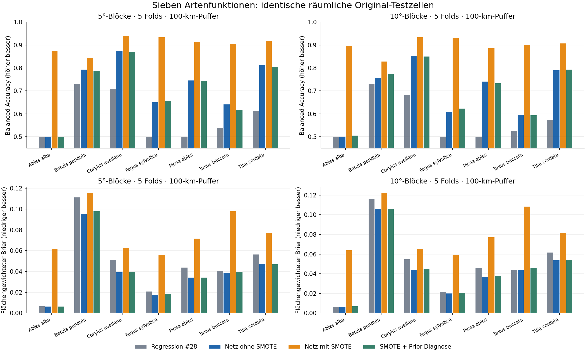

# SMOTE und einfaches Netz: sieben neue Artenfunktionen

Stand 30.10.2026. [PR #29](https://github.com/TimonNetzel/kinneret_reconstruction_python/pull/29).
Auf Nutzerwunsch wurde der in der Dissertation erfolgreiche Ansatz nachgebildet.
**Ergebnis: als Klassifikator deutlich besser; die unveränderten SMOTE-Ausgaben
sind hier zugleich schlechtere Wahrscheinlichkeitsprognosen.** Keine automatische
Übernahme in eine fossile Rekonstruktion.

Die vorab veröffentlichten Parameter und Vergleichsregeln stehen in
[DESIGN.md](./DESIGN.md) und [config.json](./config.json), gesperrt im Commit
**d47129c6b8be8bd5e73701f6137ffb196dab9d91 vor dem ersten neuronalen Fit**.
Keine Optimierung von Hyperparametern oder Schwelle nach äußeren Testergebnissen.

## Berechnetes Ergebnis

Alle Werte stammen aus denselben Original-Testzellen der unveränderten #28-
Aufteilung: je fünf räumliche Folds mit 5°-/10°-Blöcken und 100-km-Trainingspuffer.
BA = ungewichtete Balanced Accuracy bei Schwelle 0,5; höher ist besser.
Brier = flächengewichteter quadratischer Wahrscheinlichkeitsfehler; kleiner ist
besser. Die folgende Zusammenfassung ist der **ungewichtete Mittelwert über
sieben Arten**, kein gepoolter Einzelzellen-Score und kein Unsicherheitsintervall.

| Variante | BA 5° | BA 10° | Brier 5° | Brier 10° |
| --- | ---: | ---: | ---: | ---: |
| Regression #28 | 58.38 % | 57.30 % | 0.04721 | 0.04994 |
| Netz ohne SMOTE | 71.64 % | 69.20 % | 0.03975 | 0.04438 |
| Netz mit SMOTE | 90.41 % | 89.74 % | 0.07747 | 0.08245 |
| SMOTE + Prior-Diagnose | 71.15 % | 69.58 % | 0.04035 | 0.04521 |

Der reine SMOTE-Vergleich innerhalb derselben Netzklasse steigert die BA um
18,77 bzw. 20,53 Prozentpunkte und verbessert sie in **allen 14 Art×Block-Fällen**.
Der Brier wird in **allen 14 Fällen schlechter**, im Artenmittel fast doppelt
so groß. Acht von 14 SMOTE-Fällen schlagen nicht einmal die ursprüngliche
Trainingsprävalenz im Brier-Skill. Das Netz ohne SMOTE hat in allen 14 Fällen
positiven Brier-Skill und schlägt die #28-Regression im Brier in 13 von 14 Fällen;
Ausnahme ist Taxus baccata im 10°-Design. Die Netzverbesserung gegenüber #28
umfasst auch andere Modellklasse und Normierung, nicht allein SMOTE.

Die vorab vorgesehene Prior-Odds-Diagnose reduziert den SMOTE-Brier deutlich,
übertrifft das Netz ohne SMOTE darin aber nur in zwei von 14 Fällen. Im
Artenmittel bleibt sie schlechter. Der BA-Gewinn fällt dabei weitgehend weg.
Sie ist keine garantierte Kalibrierung: SMOTE verändert auch die bedingte
Verteilung der Klimamerkmale, nicht nur den Klassenprior.

Seltene Arten zeigen den Unterschied besonders: Abies alba hat ohne SMOTE bei
Schwelle 0,5 eine BA von 0,5 und mit SMOTE etwa 0,88/0,90; der Brier steigt dabei
von etwa 0,006 auf etwa 0,062/0,064. Ein höherer Anteil erkannter positiver Zellen
belegt damit keine bessere native Auftretenswahrscheinlichkeit.

### Vollständiger direkter SMOTE-Vergleich

| Art | Ohne SMOTE 5° / 10° | Mit SMOTE 5° / 10° | Brier ohne SMOTE 5° / 10° | Brier mit SMOTE 5° / 10° |
| --- | ---: | ---: | ---: | ---: |
| Abies alba | 50.00 % / 50.00 % | 87.53 % / 89.62 % | 0.00620 / 0.00643 | 0.06194 / 0.06381 |
| Betula pendula | 79.22 % / 75.70 % | 84.43 % / 82.78 % | 0.09537 / 0.10612 | 0.11546 / 0.12220 |
| Corylus avellana | 87.40 % / 85.25 % | 93.91 % / 93.35 % | 0.03908 / 0.04403 | 0.06277 / 0.06537 |
| Fagus sylvatica | 65.10 % / 60.82 % | 93.31 % / 93.08 % | 0.01763 / 0.01986 | 0.05587 / 0.05898 |
| Picea abies | 74.55 % / 74.07 % | 91.31 % / 88.65 % | 0.03401 / 0.03694 | 0.07159 / 0.07714 |
| Taxus baccata | 64.07 % / 59.56 % | 90.60 % / 90.03 % | 0.03862 / 0.04356 | 0.09779 / 0.10831 |
| Tilia cordata | 81.15 % / 79.02 % | 91.77 % / 90.64 % | 0.04735 / 0.05373 | 0.07687 / 0.08137 |

Die festen Referenz- und Prior-Diagnosewerte aller Arten stehen zusammen mit
Sensitivität, Spezifität, flächengewichteter BA, Brier-Skill und Log-Loss in
[metrics_summary.csv](./metrics_summary.csv). Alle Foldwerte, auch undefinierte
Klassifikationsmaße bei fehlender Testklasse, bleiben in [scores.csv](./scores.csv).
[reliability.csv](./reliability.csv) enthält alle zehn Wahrscheinlichkeitsbins.
Die beiden Blockdesigns verwenden dieselben Kartenquellen und sind keine zwei
unabhängigen Replikationsdatensätze; keine Signifikanz- oder Universalitätsaussage.

## Was genau nachgebildet wurde

Sieben neue botanische Artenfunktionen aus Meusel/BfN-Arealen und WorldClim 2.1
(1970–2000), BIO1 TANN in °C und BIO12 PANN in mm/Jahr. Daten, Quellenmasken,
0,5°-Arbeitsgitter, Flächengewichte und äußere Tests bleiben exakt wie in #28.
Native Kartenzellen und bestätigte Punktzellen sind positive Fälle; kartiertes
Außerhalb ist kein erhobener Abwesenheitsnachweis. Unsichere Statusangaben und
Grenzbereiche bleiben maskiert. Die großräumige Kartenbewertung ist keine
unabhängige Feldvalidierung oder ausschließlich europäische Fehlerabschätzung.

Pro Fit: T-Standardisierung und `sqrt(P) → angepasste Gamma-CDF → Probit`
ausschließlich aus dem ursprünglichen Training vor SMOTE. Ein Netz mit zwei
Eingängen, sechs sigmoidalen Hidden-Neuronen und einem sigmoidalen Ausgang,
keine Skip-Verbindungen. Binäre Kreuzentropie als gewichtete Summe plus 0,1 mal
Summe aller quadrierten Gewichte und Biases; Fallgewichte auf Mittelwert 1.
BFGS mit drei vorab fixierten, gepaarten Initialisierungen; ausschließlich das
kleinste stationäre **Trainingsziel** entscheidet. Die größere synthetische
Fallzahl verändert bei diesem festen Summen-Loss auch die effektive Bedeutung
des Decay-Terms pro Fall; sie wird nicht als zusätzliche Beobachtungsevidenz
oder mehr reale Fläche interpretiert.

SMOTE bleibt vollständig im Training: fünf nächste Minderheitsnachbarn im
normierten Klimaraum, zufällige konvexe Interpolation bis 1:1 der Zellzahlen.
Alle Originalfälle bleiben erhalten. Synthetische Fallgewichte interpolieren die
Gewichte beider Eltern; es werden keine geographischen Beobachtungen erfunden.
Die vollständige Elternspur enthält beide Original-Zell-IDs und den Mischanteil.
Kein Test- oder Pufferfall schätzt Normierung, Nachbarn, Priors oder Startauswahl.

Dissertation Kapitel 2.5, gedruckte S. 40–43, belegt SMOTE, die Normierungsidee und
eine verborgene Schicht aus `nnet`. Der alte R-Lader belegt die konkrete T-/P-
Transformation für sein Biommodell; der 2025-Artikel nennt BA und sechs Neuronen
für sein Biomnetz. **Nicht belegt sind identische historische Einstellungen
sämtlicher damaliger 279 Taxa.** Architekturgröße, Decay, SMOTE-Verhältnis,
Gamma-Schätzung und Initialisierungen dieses Versuchs sind offen vorab festgelegt.
Dies ist eine eigene Python-Nachbildung der einfachen binären `nnet`-Modellklasse
und ihres Loss, keine bitgleiche R-/caret-Reproduktion. Die historischen CRU-
Daten werden nicht durch WorldClim umgedeutet. Quellen und feste Commits stehen
in [sources.json](./sources.json); kein Quellcode aus `nnet` wurde kopiert.

## Prüfung und gespeicherte Parameter

- 198.680 Art-Zell-Labels aus gesperrten Originalquellen separat rekonstruiert;
  397.360 Testzeilen mit insgesamt 1.589.440 Wahrscheinlichkeiten nachgerechnet.
- 1.274.548 synthetische Fälle: beide Eltern ursprüngliche Minderheits-
  Trainingszellen, verschiedene IDs, korrekte Nachbarschaft und Interpolation.
  Kein Test-/Pufferelternfall. Normierung und Priors separat trainingsintern geprüft.
- Alle 154 Netzfits einschließlich 462 Optimierungsstarts: Vorwärtsrechnung,
  Zielfunktion, Gradienten, Trainingsauswahl und vollständige Parameter geprüft.
  336 Scorezeilen und 560 Reliabilitätszeilen nachgerechnet.
- Zwei ganze Läufe in allen zehn Ergebnisdateien bytegleich, einschließlich
  der 54,45-MB-Vorhersagetabelle und des 18,43-MB-Gzip-Elternprotokolls.
- Sechs neue Kerntests bestanden: alle Parametergradienten gegen finite
  Differenzen, Gamma-Transformation, Minderheitsinterpolation, doppelte
  Klimapunkte, Vorwärtsrechnung/Prior-Diagnose, Extrapolationssperre und Startwahl.

[verification.json](./verification.json) benennt gemeinsame Bibliotheken und
unabhängige Rechenwege. Der Prüfer importiert weder neuen Produzenten noch
Netzmodul; er nutzt den ausdrücklich gesperrten unabhängigen #28-Vektorleser,
BallTree statt cKDTree, direkte TIFF-Indizes und eigene Netz-/Score-Rechnung.
Die Scores werden auf den aufgezeichneten, zuvor unabhängig bestätigten
Vorhersagen neu berechnet. Bei der Prüferentwicklung wurde dadurch eine
rundungsbedingte Verstärkung winziger tanh-/Sigmoid-Tailabweichungen im Log-Loss
vermieden; keine Scores, Modellparameter oder Toleranzen nachjustiert.
Gemeinsame GDAL-/GEOS-Decoder und NumPy/SciPy sind keine unabhängige Bestätigung
der wissenschaftlichen Wahrheit jeder Quellenkartengrenze.

[models.json](./models.json) hält die 14 ausführbaren vollständigen Artennetze,
[fit_models.json](./fit_models.json) sämtliche Fold-/Vollfits und alle Starts.
[run_manifest.json](./run_manifest.json) enthält Eingabe-, Code- und Ausgabehashes;
[repeat.json](./repeat.json) bestätigt die Wiederholung. Große Vorhersagen und
Elternspuren werden anhand dieser Hashes reproduziert, nicht als Rohdaten neu
verteilt. [REPRODUCE.md](./REPRODUCE.md) liefert die vollständigen Befehle und den
Vorwärtsevaluator. Standardmäßig bleibt Extrapolation aus der ursprünglichen
Trainings-Klimahülle gesperrt; die Testauswertung behält alle Testfälle mit Supportflag.

## Bedeutung für die taxonbasierte Multiproxy-App

Die vom Nutzer erwartete Klassifikationsverbesserung lässt sich hier klar
nachbilden. Für die spätere probabilistische Klimarekonstruktion reicht sie
noch nicht: Eine neue, trainingsinterne Kalibrierung mit inneren räumlichen
Teilungen und einer unabhängigen äußeren Bewertung muss vorab festgelegt
werden. Die äußeren Testergebnisse dieses PR nicht zur weiteren Optimierung
verwenden. Ebenso offen: weitere Taxa, belegte Art-/Gattungs-Pollentyp-Zuordnung,
Kalibrierungs- und Quellenunsicherheit sowie gemeinsame Beobachtungsmodelle.
Drei Optimierungsstarts sind keine Unsicherheitsensembles.

Kein fossiler Temperatur-/Niederschlagsdurchlauf und keine neue Klimakurve.
P1 bleibt offen: physischer LGM90D→MON16-Anschluss und Korrelationsunsicherheit
fehlen. Quellenwerte, Alter, 28 Kandidaten / 41 Nichttreffer / 47 Herkunftsfragen
bleiben unverändert. Claude betreut CLI/App; keine vorhandenen Integrationsdateien
geändert. Keine Pilotfreigaben, stillen Quellenkorrekturen, Autorennachrichten
oder Merges. #18 und die feste #28-Referenz bleiben erhalten.
