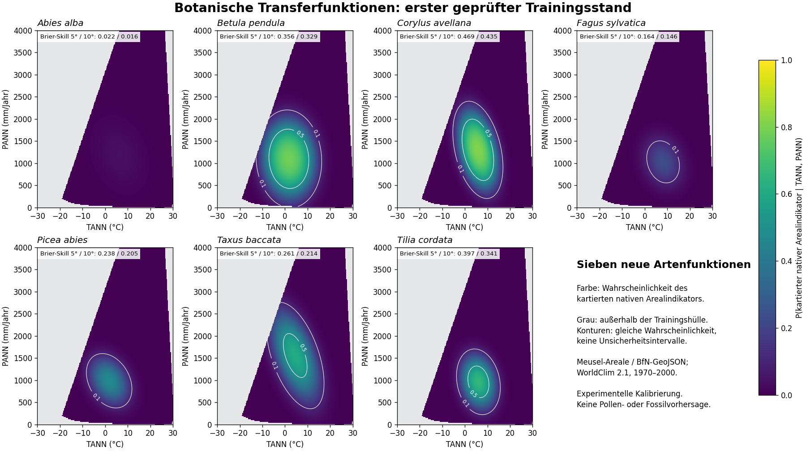

# Sieben botanische Taxon-Transferfunktionen trainiert und geprüft

Stand 30.10.2026. Neuer, ausdrücklich beauftragter Arbeitsstrang auf
`codex/netzel-taxon-response-functions`, ausgehend vom weiterhin offenen #18.
**Erster ausführbarer Trainingsstand: sieben Artenfunktionen, noch kein
vollständiges taxonbasiertes Multiproxy-Verfahren.**

Veröffentlicht als [PR #28](https://github.com/TimonNetzel/kinneret_reconstruction_python/pull/28),
geprüfter Ergebniscommit `78ab48aab1a5a81614def6683fb2a0fa78eb4845`.

## Was jetzt tatsächlich vorliegt

Sieben neue quadratische logistische Funktionen für
`Pr(kartierter nativer Arealindikator = 1 | TANN, PANN)` sind angepasst,
als [Modellparameter](./models.json) gespeichert und mit einem
[Vorwärtsevaluator](../../../tools/taxon_transfer/model.py) ausführbar.
Sie verwenden botanische Arealkarten, keine Biomzuordnung und keine aus
Pollenprozenten erfundenen Vorkommens-/Abwesenheitsdaten.

| Botanische Art | Positive Rasterzellen / alle verwendeten Zellen | Brier-Skill 5° | Brier-Skill 10° |
| --- | ---: | ---: | ---: |
| Abies alba | 181 / 28.563 | 0,022 | 0,016 |
| Betula pendula | 7.278 / 28.169 | 0,356 | 0,329 |
| Corylus avellana | 3.148 / 28.387 | 0,469 | 0,435 |
| Fagus sylvatica | 715 / 28.341 | 0,164 | 0,146 |
| Picea abies | 2.233 / 28.424 | 0,238 | 0,205 |
| Taxus baccata | 1.619 / 28.405 | 0,261 | 0,214 |
| Tilia cordata | 3.169 / 28.391 | 0,397 | 0,341 |

Skill ist `1 − Brier(Modell)/Brier(Trainingsprävalenz)` auf allen
zurückgehaltenen Zellen, flächengewichtet. 0 entspricht dem konstanten
Vergleichswert desselben Trainingsfolds, 1 einer perfekten Vorhersage.
Das sind **Karten-Klassifikationswerte, keine Klimafehler in °C/mm**.
Alle sieben Funktionen schlagen diesen Vergleich in beiden räumlichen
Designs; bei Abies alba ist der Gewinn sehr gering. Die kleine Klasse ist
keine Grundlage für einen pauschalen Qualitätsanspruch.
[Kompakte Werte](./metrics_summary.csv), [alle Fold-Scores](./scores.csv),
[Reliabilität](./reliability.csv), [Zellinventar](./sample_inventory.csv).



Die Abbildung zeigt Punktparameter des angepassten Modells. Konturen sind
Linien gleicher Wahrscheinlichkeit, keine Unsicherheitsbänder oder inversen
Klimadichten. Grau kennzeichnet Klima außerhalb der Trainingshülle.

## Quellen und bewusste neue Modellvariante

Das vollständige [Design](./DESIGN.md), [config.json](./config.json) und
[sources.json](./sources.json) wurden **vor dem ersten Fit** in
[`64120202f605406124326d0c06d42c29ac4aeb0b`](https://github.com/TimonNetzel/kinneret_reconstruction_python/commit/64120202f605406124326d0c06d42c29ac4aeb0b)
veröffentlicht. Die Arten, Quellen, Masken, Gebietsgrenzen, Regularisierung,
Foldregeln und Scores wurden nach Sichtung der Ergebnisse nicht geändert.

- **Areale:** digitalisierte Meusel-Karten aus dem von
  [FloraWeb](https://www.floraweb.de/inhalt/datenquellen.html) verlinkten
  [BfN-Repository](https://gitlab.opencode.de/bfn/open-access/floraweb/floraweb-data-maps),
  Commit `5ab8e638278c86035bf3c9c3224c90de4880327e`. Sieben Original-GeoJSONs,
  Zuordnungstabelle und beide Dokumentationen sind auf Bytezahl, SHA256 und
  Git-Blob gesperrt. Es handelt sich um generalisierte historische Areale,
  keine heutigen flächendeckenden Vegetationsaufnahmen.
- **Klima:** [WorldClim 2.1](https://www.worldclim.org/data/worldclim21.html),
  1970–2000; BIO1 = Jahresmitteltemperatur in °C und BIO12 = Jahresniederschlag
  in mm/Jahr. Original-TIFFs mit 10 Bogenminuten, direkt an den Zentren eines
  0,5°-Gitters abgelesen. Container und beide verwendeten TIFFs gesperrt.
  Kein stilles Reskalieren der Float-Temperaturen um Faktor 10, keine
  Interpolation oder künstliche Verfeinerung der Arealkarten.

Quadratische logistische Regression ist eine in Dissertation 2.5,
Gl. 2.31/2.32 beschriebene Modellklasse. Hier werden **neue Funktionen**
mit WorldClim 1970–2000 statt CRU 4.01 1961–1990 erstellt. Auch Skalierung,
Regularisierung und Validierung sind eigene dokumentierte Entscheidungen.
Die verlorenen ursprünglichen 279 Funktionen sind nicht wiederhergestellt.
Die fertige Analog-Baseline #18 und ihre Prüfreferenz bleiben unverändert.

Die sieben Zielkonzepte sind **Arten**. Die originale Schreibweise
`Fagus silvatica` und BfN-Zuordnung zu `Fagus sylvatica` bleiben sichtbar;
bei Picea abies werden Taxon-ID 10719 und Name-use-ID 10718 unterschieden.
Diese IDs sind keine Neotoma-Schlüssel. Ein Abies-, Fagus- oder Picea-
Pollentyp wird hier nicht automatisch mit einer einzelnen Art gleichgesetzt.
Die taxonomische Brücke zu den Fossildaten ist ein eigener noch offener Schritt.

## Labels, Anpassung und räumliche Prüfung

Arbeitsgebiet: 20° W–180° E, 20°–80° N, gültige WorldClim-Landzellen.
Bestätigte native Polygone liefern positive Zellzentren, bestätigte native
Punkte ihre enthaltende Zelle. Fragliche, erloschene oder synanthrope Angaben
und festgelegte Umfelder bleiben maskiert. Zusätzliche Grenz- und Punktumfeld-
masken sind vorab festgelegt; keine Geometrie wurde repariert. Die Masken sind
Arbeitsregeln in Winkelgraden, keine geschätzten geographischen Fehlerbänder.
Außerhalb des kartierten Areals bedeutet 0 **kartierter Außenbereich**,
keine bewiesene botanische Abwesenheit. Gerade diese Annahme begrenzt die
spätere Interpretation der Wahrscheinlichkeiten.

Jede Funktion verwendet `1, zT, zP, zT*zP, zT², zP²`. Mittelwerte und
Standardabweichungen werden nur am Training des jeweiligen Folds geschätzt;
Gewichte entsprechen der relativen sphärischen Zellfläche (`cos(latitude)`).
Feste Ridge-Stärke 0,001, unbestrafter Intercept. Kein SMOTE und keine
Klassenumschichtung; der Klassenanteil wird nicht künstlich balanciert.

Fünf Folds je 5°- und 10°-Blockgitter, 100-km-Puffer zwischen Training und
Test. Der tatsächlich unabhängig nachgerechnete kleinste Abstand beträgt
**100,093 km**. Vergleich ist die flächengewichtete Prävalenz desselben
Trainingssatzes. Beide Designs und alle sieben Arten werden berichtet,
ohne nachträgliche Auswahl eines „Siegers“. Testklimata außerhalb der
Trainingshülle bleiben in den Hauptscores enthalten und werden gezählt.
Die Rasterzellen und die sieben Arten sind räumlich bzw. biologisch abhängig;
die große Zellzahl ist keine entsprechende Zahl unabhängiger Beobachtungen.
Dies ist räumliche Karten-CV, kein unabhängiger Feld-, Pollen- oder Fossiltest.

Die vollständigen Modelle sind auf allen für die jeweilige Art gültigen Zellen
angepasst; ihre modern gehaltene Güte stammt aus den separat gespeicherten
[70 Fold-Modellen](./fold_models.json). Der Vorwärtsevaluator verweigert
standardmäßig Klima außerhalb der vollständigen Trainingshülle. Er liefert
Wahrscheinlichkeiten des festgelegten Arealindikators, keine bereits
normalisierte Verteilung `Pr(Klima | Pollen)`.

## Unabhängige Prüfung

Zwei vollständige Produzentenläufe sind in **allen acht Ausgaben bytegleich**,
einschließlich der rund 28,9 MB Vorhersagetabelle und Manifest.
Ein separater Prüfer importiert den Produzenten nicht und bestätigt:

- sämtliche 198.680 verwendeten Art-Zell-Labels, alle 397.360 Testvorhersagen;
- alle 70 Foldrollen einschließlich Haversine-Puffer, 84 Score- und 140
  Reliabilitätszeilen;
- Trainingsskalierung, Koeffizienten-Auswertung, Gradienten und positive
  Hesse-Matrizen aller sieben vollständigen und 70 Fold-Fits;
- Quellen- und Ausgabehashes. Größter nachgerechneter Gradient: 1,54 × 10⁻⁷.

Unabhängige Implementierungspfade: Vektorprädikate statt Rasterisierung,
direkte TIFF-Zeilen-/Spaltenindizes, Haversine-BallTree statt kartesischer
Chorddistanz/cKDTree sowie getrennte Wahrscheinlichkeits-/Score-Rechnung.
**Gemeinsame Abhängigkeiten:** Rasterio/GDAL, Shapely/GEOS und NumPy/SciPy.
Kein vollständig unabhängiger GIS-Binärdecoder oder unabhängiger Felddatensatz
wird behauptet. [Prüfprotokoll](./verification.json).

Fünf gezielte Tests prüfen analytische Ableitungen gegen finite Differenzen,
Trainingsskalierung und Extrapolationssperre, unzulässige Werte/Klassen,
Datumsgrenzen-Puffer sowie Quellstatus/Punktzellen/ungültige Geometrien.
Die drei GIS-unabhängigen Kerntests liegen in der gewöhnlichen Testsuite;
zwei weitere benötigen die optionalen GIS-Pakete.

## Reproduktion und Nutzung

Keine alten Chat-Zwischendateien nötig. Alle Originale und gesperrten URLs
stehen in [sources.json](./sources.json). Die zehn BfN-Dateien unter ihren
relativen Pfaden in einem neuen Eingangsverzeichnis bereitstellen und den
WorldClim-ZIP separat laden. Der normale Git-Zugang zum BfN-Repository
funktionierte; die Webansicht zeigte teilweise eine Bot-Prüfung. Die
Repository-Programme werden nicht ausgeführt.

Mit Git ist beispielsweise eine gezielte Beschaffung möglich (Pfadvariablen
an die eigene Umgebung anpassen):

```sh
git clone --filter=blob:none --no-checkout https://gitlab.opencode.de/bfn/open-access/floraweb/floraweb-data-maps.git /pfad/bfn_git
git -C /pfad/bfn_git fetch origin 5ab8e638278c86035bf3c9c3224c90de4880327e
```

Dann die zehn expliziten `map_files.path` aus `sources.json` mit
`git show 5ab8e638278c86035bf3c9c3224c90de4880327e:RELATIVER_PFAD`
auslesen und unter denselben relativen Pfaden ablegen. So werden keine
fremden R-Programme oder das große generierte Kartenarchiv benötigt.

Eine frische Python-Umgebung gemäß
[requirements.txt](../../../tools/taxon_transfer/requirements.txt) verwenden.
Aus der Repository-Wurzel:

```sh
OPENBLAS_NUM_THREADS=1 OMP_NUM_THREADS=1 python tools/taxon_transfer/calibrate.py --maps /pfad/bfn_eingaenge --climate /pfad/wc2.1_10m_bio.zip --config docs/thesis_research/taxon_transfer_2026_10_30/config.json --sources docs/thesis_research/taxon_transfer_2026_10_30/sources.json --output /pfad/neuer_lauf
OPENBLAS_NUM_THREADS=1 OMP_NUM_THREADS=1 python tools/taxon_transfer/verify.py --maps /pfad/bfn_eingaenge --climate /pfad/wc2.1_10m_bio.zip --config docs/thesis_research/taxon_transfer_2026_10_30/config.json --sources docs/thesis_research/taxon_transfer_2026_10_30/sources.json --output /pfad/neuer_lauf --report /pfad/pruefung.json
python -m unittest discover -s tests -p test_taxon_response.py -v
python -m unittest discover -s tools/taxon_transfer -p test_transfer.py -v
python tools/taxon_transfer/plot_responses.py --models /pfad/neuer_lauf/models.json --scores /pfad/neuer_lauf/scores.csv --output /pfad/responses.png
```

[reference_manifest.json](./reference_manifest.json) sperrt die acht
reproduzierbaren Laufdateien; die große `predictions.csv` wird nicht
eingecheckt. Die übrigen sieben Dateien liegen hier, das Manifest unter dem
Namen `reference_manifest.json`. `metrics_summary.csv` ist die Auswahl der
14 Zeilen `scope=all` aus `scores.csv`. Die Abbildung ist ein separater,
aus den gespeicherten Parametern reproduzierbarer Ergebnisblick.

Python-Beispiel für eine ausdrücklich benannte Art:

```python
import json
from tools.taxon_transfer.model import probabilities
models = json.load(open("docs/thesis_research/taxon_transfer_2026_10_30/models.json"))
p, in_support = probabilities(models["fagus_sylvatica"], [[8.0, 1000.0]])
```

Quellenangabe der Areale: Hermann Meusel & Eckehart J. Jäger (Hrsg.).
Vergleichende Chorologie der zentraleuropäischen Flora. Band I, II & III.
Jena/Stuttgart/New York: Gustav Fischer, 1965, 1978 & 1992. Digitalisiert
bereitgestellt von Gunnar Seidler, Erik Welk & Helge Bruelheide, Lehrstuhl
Geobotanik, Institut für Biologie/Bereich Geobotanik und Botanischer Garten,
Martin-Luther-Universität Halle-Wittenberg. Areale: CC-BY 4.0. Klima: Fick &
Hijmans (2017), WorldClim 2; [Nutzungsbedingungen](https://www.worldclim.org/about.html).
Originalraster und Rohzählungen werden nicht unter die MIT-Code-Lizenz gestellt
oder weiterverteilt. Das Original-ScienceDirect-ZIP wurde nicht benötigt.

## Was als Nächstes fachlich nötig ist

Weitere Arten/Areale ergänzen und die Typ–Art-/Gattungszuordnung prüfen,
einschließlich unvollständiger Gattungsabdeckung. Den geringen Abies-Gewinn
und Reliabilität sowie die Sensitivität auf Regularisierung, Gebiet,
Kartenmasken und Klimaquelle untersuchen; dafür neue Prüfungen vorab festlegen.
Parameter-/Kartenunsicherheit fehlt als Verteilung bislang und muss vor
belastbaren fossilen Fehlerbändern ergänzt werden. Korrelationen zwischen
Taxa und ein gemeinsames Pollen-Beobachtungsmodell explizit behandeln.

Keine automatisch freigegebene fossile Anwendung oder neue Klimakurve.
Monticchio-P1, physischer MON16-Crosswalk und Korrelationsunsicherheit bleiben
offen; die 28 Kandidaten/41 Nichttreffer aus #26/#27 bleiben unverändert.
Claude betreut weiterhin CLI/App, Codex Kalibrierung, Quellen und Prüfung.
Keine Autorennachricht, Quellenkorrektur oder Merge.
